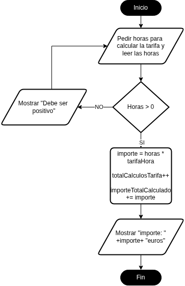
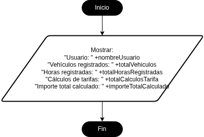
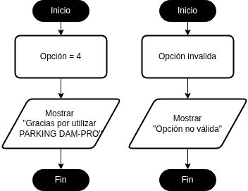

# PARKING DAM-PRO 

----
## Relación entre diagramas y código

----
### Inicio


El diagrama represnta la función Main, que tan solo se encarga de recibir al usuario y guardar su nombre, alojando el resto de funciones. 

### Menú


El diagrama representa la función de mostrarMenu, que se encarga de mostrar el menú y manejar el switch que usan el resto de funciones. Lo he implementado con un bucle do while y un switch que se encarga de mostrar el menú y leer una opción mientras el usuario no seleccione la opción 4, que es la salida.


### Registro de vehículos


El diagrama representa la función de registrarVehiculos, que se encarga de registrar los vehiculos y las horas de parking del usuario. He usado un bucle for para registrar todos los vehiculos uno a uno.

### Validaciones y cálculo de tarifas



El diagrama representa la función de calcularTarifa, que se encarga de calcular el importe a través de las horas totales. He usado un bucle do-while y un if para comprobar que las horas sean positivas, y en caso contrario mande al usuario al menú de nuevo.

### Resumen



Representa la función mostrarResumen, que se encarga de mostrar un resumen de todas las operaciones hechas por el usuario junto a otros datos. Simplemente usé un "sout" para cada uno de los datos que necesita decir.

### Salida y opción invalida



No representan ninguna función, simplemente son opciones dentro del switch de menú que escriben un mensaje y reinician el loop o finalizan el programa.

## Funciones implementadas

---

### mostrarMenu()

Funcion que muestra un menú. Dentro de ella se encuentran el resto de funciones (Menos la main). Se encarga de mostrar el menú a través de un "do-while" y un "switch" que sirven a modo de loop.

### registrarVehiculos()

Funcion que registra los vehiculos y las horas de parking del usuario. Se encarga de a través de un bucle "for" de guardar el numero de vehículos del usuario, sus matriculas y las horas que lleva cada uno en el parking. Modifica la variable totalVehiculos y totalHorasRegistradas que la función calcularTarifa y mostrarResumen usan más adelante.

### calcularTarifa()

Funcion que calcula el importe del usuario. Usa un "if" para revisar si el usuario ha introducido ya las horas de parking, y despues tan solo hace los calculos y los devuelve a través de las variables importeTotalCalculado y tarifaHora. También añade uno al contador totalCalculosTarifa para mostrarlo en el resumen.

### mostrarResumen()

Funcion que muestra el resumen de lo que ha hecho el usuario. Usando las variables que el resto de funciones le han aportado, como: nombre, totalVehiculos, totalHorasRegistradas, totalCalculosTarifa y importeTotalCalculado.

## Historial de desarrollo con Git

---

Estos son los commits que he hecho hasta ahora:
```
403a8f0 (HEAD -> main, origin/main, origin/HEAD) Empezando README
0118030 diagramas completados
ec76d7d diagrama 4 terminado
0839526 tercer diagrama completado
fd334b3 Creando primeros diagramas
5ac5e94 Ultimos detalles del codigo
95d6737 Arreglando error en el bucle del menu
e40ae04 opciones default y de salidad añadidas, programa funcional
cf7d914 arreglando errores por todos lados y empezando funcion de mostrar el resumen
ccbc3a1 cambios provisionales
95d429d Se añade la tercera función, de calcular tarifa
01bf17c función de registrar vehiculos completada
af92338 Función del menu añadida
faa5625 diagrama 2 pasado a codigo, menu
c6ec636 Primer diagrama pasado a codigo
6445610 creando documento y estructura
5a9ee3d Borrando gitignore
cbb6194 Initial commit
```
## Dificultades y soluciones

---

El mayor problema que tuve fue conseguir que las funciones pudiesen leer y modificar variables que usaban varias funciones a lo largo del uso del programa y cambiaban constantemente. Al final lo sulucioné con la ayuda del profesor declarando las variables fuera de ninguna función, usando este método: `static int totalVehiculos = 0;`.

## Conclusión

---

El programa funciona correctamente y en el proceso he aprendido a usar mejor las funciones, a parte de hacer los diagramas. También me he acostumbrado más a usar git y sus comandos en el proceso de completar la tarea.