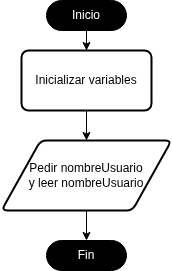
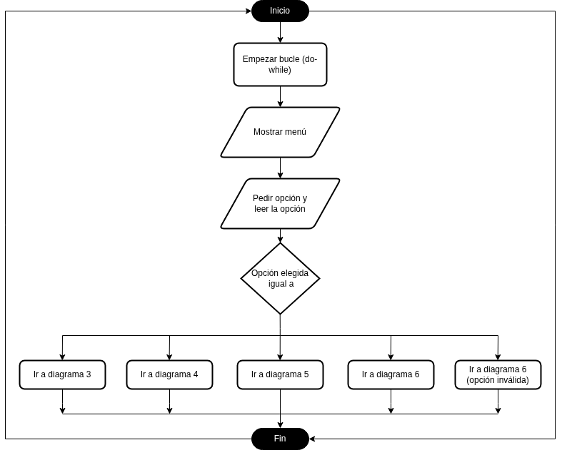
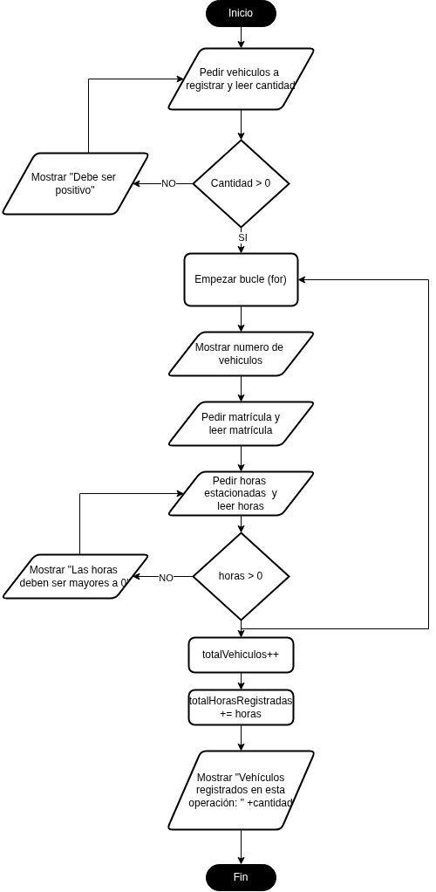

# PARKING DAM-PRO 

# 1. Relación entre diagramas y código
## Inicio

El diagrama represnta la función Main, que tan solo se encarga de recibir al usuario y guardar su nombre, alojando el resto de funciones. 
## Menú

El diagrama representa la función de mostrarMenu, que se encarga de mostrar el menú y manejar el switch que usan el resto de funciones. Lo he implementado con un bucle do while y un switch que se encarga de mostrar el menú y leer una opción mientras el usuario no seleccione la opción 4, que es la salida.

## Registro de vehículos

El diagrama representa la función de registrarVehiculos, que se encarga de registrar los vehiculos y las horas de parking del usuario. He usado un bucle for para registrar todos los vehiculos uno a uno.

## Validaciones y cálculo de tarifas

El `while` se utiliza para [explica qué dato se valida].
La tarifa se calcula [indica la fórmula y un ejemplo real].

## Métodos implementados

### mostrarMenu()

Este método [qué hace, qué recibe y qué devuelve].

### leerEnteroPositivo(...)

Este método [parámetros, validación y resultado].

### registrarVehiculos(...)

Este método [qué hace el for y cómo actualizo los acumuladores].

### calcularTarifa(...)

Este método [parámetros, valor devuelto y ejemplo].

### mostrarResumen(...)

Este método [explica qué información muestra].

## Historial de desarrollo con Git

[Indica al menos tres commits relevantes y qué modificaste en cada uno.]

## Dificultades y soluciones

[Describe una dificultad auténtica y los pasos que seguiste para resolverla.]

## Conclusión

[Explica qué aprendiste sobre métodos, bucles y Git.]   